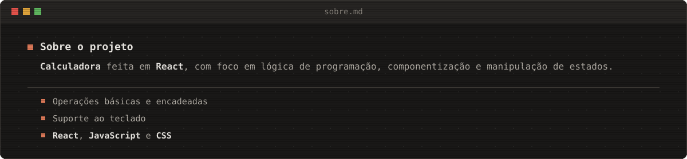
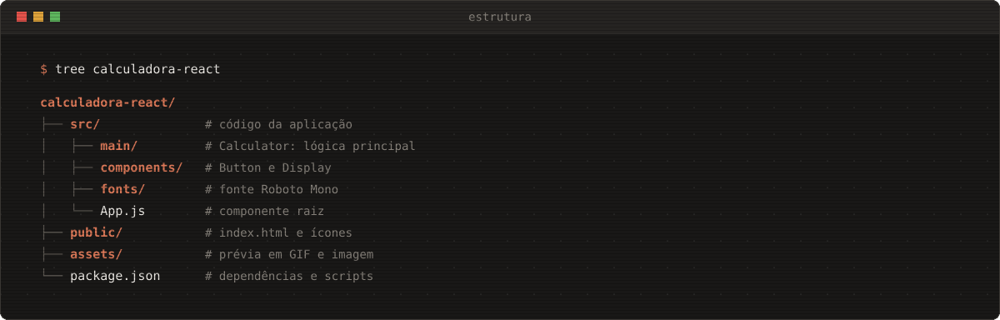

```bash
git clone https://github.com/GabrielCardossso/calculadora-react
cd calculadora-react
npm install
npm start          # abre em http://localhost:3000
```

Para gerar a versão de produção: `npm run build`.



A calculadora tem um sistema de operações encadeadas parecido com o de calculadoras reais. Em `10 + 10 + 5`, ela:

- calcula automaticamente a operação anterior ao escolher o próximo operador;
- mantém o fluxo da conta e atualiza o display em tempo real;
- ao pressionar `=`, mostra apenas o resultado; ao começar uma nova operação, o cálculo continua normalmente.

### Atalhos do teclado

| Tecla | Ação |
| --- | --- |
| `0`–`9` | Digita o número |
| `.` ou `,` | Ponto decimal |
| `+` `-` `*` `/` | Escolhe a operação |
| `Enter` ou `=` | Mostra o resultado |
| `Esc` ou `Delete` | Limpa tudo (AC) |



- Componentização e props.
- Estados e eventos (cliques e teclado).
- Manipulação do DOM com React.
- Organização de projeto e CSS separado por componente.
- Lógica de programação e operações matemáticas.



<div align="center">
  
</div>

<a href="https://github.com/GabrielCardossso"></a>
